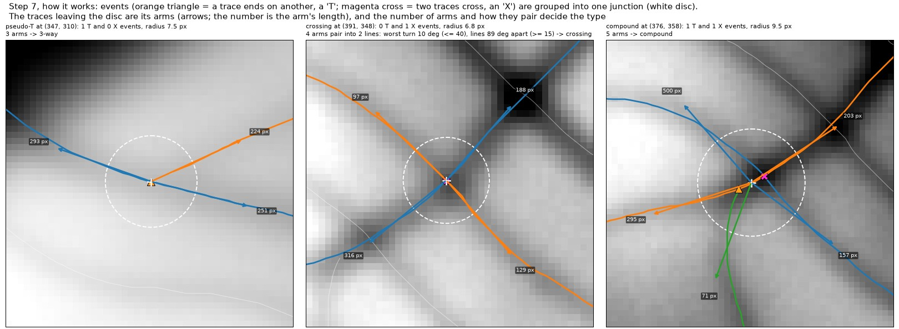
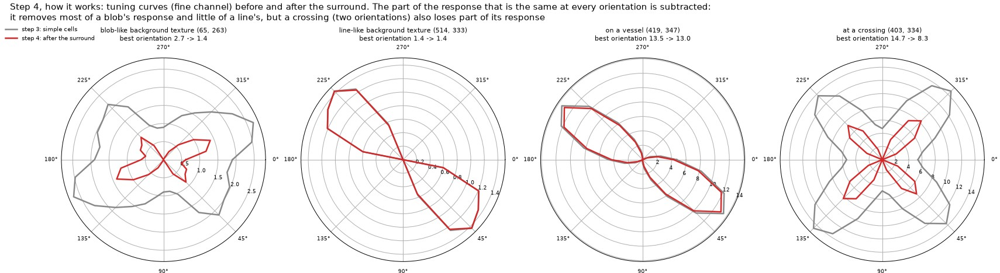

# Tech spec: recurrent mid-level vision for the vessel annotator (V2 junction cells, recurrent horizontal connections, border ownership, attentive grouping, top-down feedback, population codes, motion)

| | |
|---|---|
| status | in progress: revision 2, 11 October 2026 (first version 8 October). Section 1.1 lists what changed |
| author | Claude, for Karim Ghabra |
| code | MICA (`v1.py`, `readout.py`, `v2.py`, `fusion.py`, `attend.py`, ...): the implementation. vesselscene: `experiments/splinefit/` (fit, evaluator, scorers) and `experiments/neuromimetic/` (the original proposer, now the baseline) |
| plan | [MICA_PLAN.md](MICA_PLAN.md): build order, layer numbers ("layer 07"), figures |
| background | [PIPELINE.md](PIPELINE.md) (how every step works), [REPORT.md](REPORT.md) (results) |

## 1. Summary

The annotator's neural layers stop at the level of primary visual cortex (V1), and only at its feedforward
sweep. They find oriented line segments at several sizes (steps 3-4) and link collinear ones with three fixed,
excitatory steps (step 5). Everything above that is done with symbolic rules:

- tracing vessels (step 6);
- finding and typing junctions from where traces end (step 7);
- deciding which arms continue each other (step 9).

Nothing feeds back: the fit never changes what the early layers see.

Junctions are where the system fails. Over the 500 junctions of the six held-out images, 61 % are found, 34 %
get the right type, and 21 % are found, correctly typed and rendered to 95 %. Only 38 % of 3-way junctions are
found.

The visual system solves the same problem in two phases (Lamme and Roelfsema 2000): a fast feedforward sweep
that extracts local features everywhere, then recurrent processing in which horizontal and feedback connections
group features into objects, assign figure and ground, and interpret junctions. This spec adds the recurrent
phase, in four groups.

**V2 junction computations (phases 1-3):**
1. **End-stopped cells:** a dense map of line terminations, computed from the existing association field.
2. **Junction cells:** at every pixel, the arms meeting there, from line ends and passing lines; presence and
   type follow from the arms, with no tracing needed.
3. **Good continuation:** which arms continue each other, from co-circularity and width (revised: a straight
   turn rejected curved vessels).
4. **Transparency:** fork or crossing, from the optical density (OD) at the centre against the arms', on the OD
   itself.
5. **Local model comparison:** for ambiguous junctions, the junction-aware renderer draws each hypothesis and
   keeps the best (top-down feedback at one junction).
6. **V1 fixes:** a surround that stops penalising crossings; divisive normalisation and complex cells as tested
   variants; scale selection across the size channels (added in revision 2).

**Recurrent grouping (phases 4-5):**
7. **Recurrent horizontal connections with inhibition:** step 5 becomes a proper recurrent field, more steps,
   excitatory collinear support and inhibition from parallel neighbours and from nearby orientations.
8. **Curvature: arc cells.** Short straight cells pooled along circles, curvature competing like width, and
   co-circular association fields (revised: the first version bent only the lobes).
9. **Border ownership and grouping cells:** a vessel is a dark strip owning both of its borders; grouping cells
   at the strip's midline give its centre and width and reject one-sided edges.
10. **Incremental grouping with attention:** vessels grouped one at a time by an attentional label that spreads
    along the vessel, boosts its weak stretches, follows good continuation at junctions and is then inhibited
    from restarting there. Revision 2 adds the readout per orientation and evidence fusion that feed it, and the
    linking of facing label ends.

**Top-down and parameters (phases 6-7):**
11. **Top-down feedback to V1:** the render's prediction error modulates the early layers near traced ends and
    junctions (predictive coding), within the proposer and from the fit back to the proposer.
12. **Population codes for the spline parameters:** position, tangent, width, blur, contrast and curvature
    decoded from the populations, to start the fit.
13. **Surface completion:** the background behind vessels completed only behind real vessels.

**Motion (phase 8):**
14. **A motion channel for real bursts:** flowing red cells make the lumen flicker over time, a vessel cue
    independent of darkness; direction-selective units along each vessel give flow direction, and so
    bifurcation against confluence.

Across all phases, an optional step tunes a few dozen parameters by gradient on vesselscene's dense labels,
with the architecture still built by hand. Everything stays deterministic and interpretable. Each phase is
gated on the existing evaluator before the next starts.

### 1.1 Revision 2: what the build changed

The layers are being built in MICA, Karim's code for real bursts, in the order of MICA_PLAN.md, whose layer
numbers are used below. As of 11 October 2026:

| | layers | gate |
|---|---|---|
| built | 03 surround with the crossing fix; 06 readout per orientation; 07 end-stopped cells; 08 junction cells; 09 good continuation; 10 transparency; 11 grouping cells; 13 evidence fusion; 14 attentive grouping and linking; scale selection (new) | none measured against truth yet |
| built, switched off | 04 recurrent field | failed its gate on the real test image |
| designed, not built | 05 arc cells (replaces the bent lobes of the first version) | reference test in 4.8 |
| not started | 12 flicker; 15 graph and fit; 16 model comparison; 17-20 | |

Changes to the design, each in its section:
1. **Rules replaced by inhibitory interactions** in the end-stopped and junction cells (4.2, 4.3).
2. **Scale selection across size channels** (new, 4.6b): a coarse cell no longer answers for a thin vessel past
   its end.
3. **The association field's lobes are too thin** (4.7): 1-px rays slide off the crest of any vessel not aligned
   with one of the 16 orientations.
4. **Curvature by arc cells** (4.8, rewritten): elongation moves from the simple cell into pooling along arcs.
5. **Evidence fusion and the readout per orientation** (new, 4.9b, 4.9c).
6. **Attentive grouping as built, and linking of facing ends** (4.10, 4.10b).
7. **Good continuation by co-circularity** (4.4): facing ends of curved vessels were rejected by the straight turn
   term.
8. **Widths are the OD's half-height width everywhere** (4.4); a binary-mask width was rejected (section 8).
9. **From vesselscene to real images** (new, 6.4): why tuning on synthetic scenes should transfer, why it might
   not, and the two gates every change must pass.

Numbers reported from MICA come from one real test burst and the synthetic scenes of MICA's
`layer_figures.synthetic_scenes`, as logged in its `LAYERS_LOG.md`; the others are from runs of Karim's earlier
`neuro.py` on synthetic vessels (6 px wide, peak OD 0.15, white noise 0.01 OD). None is checked against truth yet.

## 2. Problem and evidence

### 2.1 Junctions are where the graph is lost

Per-junction scorecard of the fitted output, the 6 held-out averages (`junction_gallery.py`; found = a junction
within the strict radius of 23.8 px):

| junction type | n | found | right type | render >= 95 % | all three |
|---|---|---|---|---|---|
| 3-way | 176 | 38 % | 24 % | 52 % | 11 % |
| crossing | 135 | 73 % | 36 % | 53 % | 23 % |
| compound | 189 | 74 % | 42 % | 54 % | 30 % |
| all | 500 | 61 % | 34 % | 53 % | 21 % |

### 2.2 Why: junctions are built from traces

Step 7 makes a junction only where a trace ends on another trace or two traces cross, and types it by counting
the traces that leave its disc ([PIPELINE.md](PIPELINE.md), step 7). So:

- **A 3-way junction needs a trace to reach its parent.** If the branch's trace stops short, never reaches the
  parent, or is pruned, the junction is lost.
- **Typing is detection-limited** (NOTES_neuromimetic.md). Truth compounds have 5-6 lines and tracing finds 3-4.
  Most crossings typed 3-way are missing their fourth arm.
- **Fork against crossing is never tested.** Four arms that pair into two straight lines make a crossing; nothing
  checks the image at the centre.



*Step 7 today: events from traces, a disc, arms counted from traces.*

### 2.3 What was tried and must not be repeated

| attempt | result | what this spec does differently |
|---|---|---|
| the "knot" cue: residual of the additive render at junction centres | did not separate types (medians -2.4 crossings, -1.8 compounds, -1.4 3-ways, in thinner-arm contrasts): the additive render over-predicts every junction | measure transparency on the OD itself, not on a render's residual |
| merging nearby junctions, counting all traces through a region, a crowding rule | traded junction recall for typing | arms from the orientation field, not from traces |
| weaker cross-orientation suppression (cross_k 0.5); facilitation-only association | within noise | change which part of the tuning curve counts as orientation-blind (section 4.6), measured on crossings first |
| re-proposing traces from the residual, across the image | lowered every score; added junctions faster than true lines (junction precision from 0.82 down) | feedback as a gain on existing evidence near traced ends and junctions only (4.11), and as a choice between hypotheses at junctions (4.5b) |
| linking pieces after tracing (E22) | lent length to false pieces | continuation decided at junction cells, inside grouping |
| a background mask from OD amplitude (E24) | also took dark texture, biased B | motion as the extra mask cue (section 4.14): independent of darkness |
| patching V2 defects with rules: a second-lobe test, a gate at 2 x the median, a boolean veto, spur pruning (MICA, revision 2) | removed spurious ends but broke junctions | inhibitory interactions between cells (4.2) |

### 2.4 The surround penalises crossings



*Step 4 on four pixels of the development image: a blob loses half its response (2.7 to 1.4), a vessel 4 %
(13.5 to 13.0), a crossing 44 % (14.7 to 8.3). A crossing's two lobes raise the "orientation-blind" part.*

The loss depends on the crossing angle and on how unequal the two vessels are, because the floor is set mostly by
the stronger vessel and subtracted from every orientation alike (Karim's `surround`, synthetic vessels):

| crossing | floor | stronger vessel's cell | weaker vessel's cell |
|---|---|---|---|
| equal vessels, 90 deg | 20.4 | -23 % | -23 % |
| equal, 45 deg | 10.5 | -11 % | -11 % |
| equal, 30 deg | 6.1 | -5 % | -5 % |
| 0.05 OD across 0.15 OD, 70 deg | 10.8 | -12 % | -35 % |
| 0.03 OD, 3 px wide, across 0.15 OD, 70 deg | 7.8 | -7 % | -48 % (16 to 8.3, at the tracking start threshold) |

The same test shows the flank term is weak: a bar inside a dense parallel texture loses 15 % in all (45 to 38.5).
Taking the weaker flank does protect a vessel with one parallel neighbour 12 px away: it loses 2 %, against 14 %
if both flanks were summed.

## 3. Goals and non-goals

**Goals (phases 1-3).**
- Raise the share of true junctions found, above all 3-way junctions.
- Raise the share typed correctly (3-way, crossing, compound).
- Do this without more false junctions (on the probes and on empty background).
- Keep the pipeline deterministic, hand-built and interpretable: every new map is a neural population with a
  stated tuning, and every parameter is set by hand or swept on development scenes only.

**Goals (phases 4-8).**
- Vessels with identity through junctions (continuous vessels), from recurrent grouping, not from linking pieces.
- Fewer false responses on background texture, from recurrent inhibition and border ownership.
- Feedback from the render to the early layers that finds missing arms without adding false junctions.
- A better start for the fit from population-decoded parameters.
- A darkness-independent vessel cue, and flow direction, on real bursts.

**Goal (all phases, revision 2).** Gains that transfer to real stills, shown by the real-data gate of 6.4 as well
as the synthetic one.

**Non-goals.**
- Training a network (hGRU, CNN). Section 8 says why.
- Changing the spline fit (steps 10-12) or the evaluator.
- Bifurcation against confluence from a still (it needs flow direction: 4.14 gets it from bursts).
- The 95 % per-junction bar itself: this spec targets detection and typing, the first two of its three tests.

## 4. Design

### 4.0 Conventions (revision 2)

- **Sheets and stacks.** A layer's output is kept per orientation: for each size channel, 16 maps ("sheets"), one
  per preferred orientation, each the size of the channel's grid. Read through one pixel, the 16 values are that
  hypercolumn's tuning curve; read across one sheet, they show where that orientation is active. Widths, and with
  4.8 curvatures, compete inside the hypercolumn: the best wins and its value is kept in a map (S, K), so later
  layers still see 16 sheets per channel.
- **Drive and rate.** A cell's drive is its net input, excitation minus inhibition, like the membrane potential
  relative to threshold; it can be negative. Its rate is max(0, drive), the threshold-linear form of the
  linear-nonlinear model (Carandini and Ferster 2000). Inhibition is computed from other cells' rates and
  subtracted from, or divides, a cell's drive.
- **Noise units.** Every drive is divided by how much that cell type fluctuates over background pixels nearby (the
  background mask of step 1), so 8 means eight times the cell's background variability, and thresholds carry over
  between bright and dim frames. Later layers keep these units without renormalising.
- **Lines exist only from the readout on.** Up to the association field there are only rates; centrelines,
  traces, vessels and junction lists are decoded from them (4.9c onward).

### 4.1 Overview

```
FEEDFORWARD SWEEP
image -> [1 retina: OD, background (4.13 surface completion)] -> [2 ganglion cells]
      -> [3 simple cells, short (4.8)] -> [3b arc cells: curvature competes like width (4.8)]
      -> [4 surround (4.6: crossing fix, divisive option)] -> [4b scale selection across channels (4.6b)]

RECURRENT PROCESSING
      -> [5' association field: lobes with width, along the winning arc (4.8); recurrent, inhibition (4.7)] <---+
            |                                       |                                                          |
            v                                       v                                                          |
   [V2a end-stopped cells (4.2)]           [V2 border ownership + grouping cells (4.9)]                        |
            v                                       v                                            top-down gain |
   [V2b junction cells (4.3)]              [evidence fusion: line + two-border (4.9b)]                  (4.11) |
     ^ [V2c co-circular continuation (4.4)]         v                                                          |
     ^ [V2d transparency (4.5)]            [readout per orientation (4.9c)]                                    |
     +-- ambiguous --> [V2e local model comparison (4.5b)]                                                     |
            |                                       v                                                          |
            +----------------------------> [attentive grouping (4.10); linking facing ends (4.10b)]            |
                                                    v                                                          |
   [7' graph: typed junctions, vessels with identity] -> [8 render, prune] ------------------------------------+
            v                                                                                                  |
   [population codes -> start values (4.12)] -> [9-12 spline fit] ---------------------------------------------+

[4.14 motion] registered burst -> flicker map -> step 1 mask, step 3 drive; direction -> flow, bifurcation/confluence
```

All maps are computed per channel on the channel's grid, like steps 3-5, and brought to the full grid. The
recurrent loops run a fixed number of iterations, so the pipeline stays deterministic.

### 4.2 V2a. End-stopped cells

**Biology.** End-stopped (hypercomplex) cells respond to a line that ends inside their receptive field; the
standard model takes a line detector's response minus the response displaced along the line beyond the end
(Heitger, Rosenthaler, von der Heydt, Peterhans and Kübler 1992). They are the complement of the bipole cells of
step 5, which need support on both sides.

**Computation.** Step 5 already computes, for every layer k, the lobes ahead and behind on its final iteration:
`A+_k(p)` and `A-_k(p)` (weighted means of the pooled response along `+t_k` and `-t_k`). Then, for the two
directions a line in layer k can end:

```
E_fwd[k](p) = max(0, min(C[k](p), A-[k](p)) - beta * A+[k](p))     # line here and behind, none ahead:
                                                                    # an end at p, free side +t_k
E_bwd[k](p) = max(0, min(C[k](p), A+[k](p)) - beta * A-[k](p))     # free side -t_k
```

This gives 32 direction channels (16 orientations x 2), an end's free direction covering 360 degrees.
`beta` = 1 to start. A gate `C[k](p) > t_low` keeps ends on lines only.

**Output.** `ends[c]`, shape (32, H, W) per channel c, in contrast-to-noise units.

**Cost.** Uses step 5's lobes; about 2 extra correlations per layer per channel (step 5 does 2 per iteration).

**As built (layer 07, revision 2).** The first version patched defects with rules: a second-lobe test, a gate at
2 x the median, a boolean veto and spur pruning. Together they removed spurious ends but broke junctions. They
were replaced by inhibitory interactions:
- **Untuned suppression on the completed response,** pooled over 3 px: a blob-like response, as at a line end,
  drives every orientation and is suppressed in all of them.
- **Winner-take-all among the nearest rivals:** the cells beside a cell across the vessel, and the neighbouring
  orientations at its pixel.
- **End-stopped cells inhibit the bipole cell of their own orientation:** a line that ends near a point does not
  pass through it.

Correct on a synthetic line end. On the real test image it finds 1,399 ends, too many: a real vessel's strength
varies along it, and the subtractive form fires a little wherever the vessel weakens ahead. Stronger inhibition
from ahead (larger beta) cuts the ends to 185 but mistypes the synthetic T and raises real crossings from 227 to
496, probably because beta also sets the end-to-bipole inhibition: fewer ends, more passing lines survive. The
setting that keeps the synthetic cases right is kept.

**Next variants (not yet tested):**
- Give the end-to-bipole inhibition its own weight, so beta tunes end selectivity alone.
- Divisive end-stopping, normalised by the local line activity (shunting inhibition by the local pool):
  `E = [A- - beta A+]+ / (A- + A+ + c)`, gated by C > t_low as before. A real end gives about 1 at any contrast;
  a 20 % dip on a strong vessel gives about 0.1; c, in noise units, keeps noise-level lines from high ratios.

### 4.3 V2b. Junction cells

**Biology.** V2 has cells selective for angles and junctions (Ito and Komatsu 2004): they combine line
terminations and passing lines at different orientations around one point.

**Computation.** For each pixel p, the arms meeting there are gathered from a disc of radius
`rho(p) = r0 + w(p) / 2` (r0 = 4 px; w = the local width, 2.5 x the winning scale):

```
arms(p) = []
# line ends pointing into p: an end at q whose free side u points at p, within the disc
for each direction j (free side u_j):
    e_j(p) = max over q in the disc along -u_j from p (q = p - d u_j, d <= rho) of E[j](q)   # a "ray" kernel
    if e_j(p) > tau_end: arms += (direction -u_j, strength e_j, kind 'end')
# lines passing through p
for each orientation k:
    b_k(p) = the bipole of step 5 at p, sqrt(A+ x A-)
    if b_k(p) > tau_pass and k is a local peak over orientation: arms += (+t_k, b_k, 'pass'), (-t_k, b_k, 'pass')
merge arms within 22.5 deg of each other (keep the stronger)
n(p)  = number of arms
J3(p) = the 3rd-largest arm strength                     # a junction needs 3 arms; its evidence is the 3rd
```

Junctions are the local maxima of `J3` above `tau_J`, at least r0 apart (non-maximum suppression, like corners
from the 2nd eigenvalue of a structure tensor). The junction's arms are `arms(p*)` at the maximum.

**Type (first pass, refined by 4.4-4.5):**

| arms | pattern | type |
|---|---|---|
| 3 | one passing line + one end | 3-way (T) |
| 3 | three ends | 3-way (Y) |
| 4 | two passing lines, at least 15 deg apart | crossing candidate |
| 4 | four ends that pair into two lines by good continuation (4.4) | crossing candidate (broken at the centre) |
| 4 | otherwise | compound |
| 5 or more | | compound |

The compound radius prior of step 7 (a region of radius >= 16 px is compound) is kept as a separate flag and
measured with and without.

**Why it can find what tracing misses.** Arms come from the orientation field around the point, not from traces
that reached it. A branch with field support near its parent counts even if its trace stopped short. An arm with
no field support is still missed: phase 1 measures how much of the loss is of each kind.

**Cost.** One ray kernel per end direction (32) and channel; a disc gather per pixel. Comparable to step 5.

**As built (layer 08, revision 2).** The synthetic T, Y and crossing are typed correctly. The real test image
gives 444 junction cells (227 crossings, 162 3-way, 55 compound), 425 after scale selection (4.6b). Ten lie more
than 15 px from any centreline: either branches whose traces stopped short, which this layer exists to find, or
noise. Besides firing thresholds, one rule remains: the third arm must be at least 15 % of the strongest (a
candidate for a divisive form, J3 / (J1 + c)). The junction cells read V1 directly, not the fused evidence of
4.9b.

### 4.4 V2c. Good continuation

**Biology.** Contour integration follows good continuation: two segments are grouped when one continues the
other with a small turn (Field, Hayes and Hess 1993). At junctions it decides which arms belong to one curve.

**Computation.** For two arms a, b of one junction (outward directions u_a, u_b; widths w_a, w_b, each measured as
the OD width at half height along a 2 r-long stretch of the arm, as `od_widths`):

```
turn(a, b) = angle between u_a and -u_b                       # 0 for a straight continuation
cont(a, b) = exp(-turn^2 / (2 * 20 deg^2)) * exp(-ln(w_a / w_b)^2 / (2 * ln(1.5)^2))
```

- **Crossing:** the pairing of 4 arms into two lines with the largest product of `cont` (both above 0.3).
- **Fork:** the parent is the pair with the largest `cont`; the third arm is the branch. A soft Murray check,
  `r_parent^3 ~ r_1^3 + r_2^3`, is reported as a diagnostic, not used to decide, in phase 2.

**Output.** Per junction: arm pairings with scores. Used by step 9 instead of the same-trace rule.

**Revision 2: co-circularity instead of a straight turn.** Measured on MICA's label ends (4.10b), facing ends are
typically 23 deg apart across a 12 px gap: exactly the turn of a bend of radius about 30 px
(turn = 2 asin(d / 2r)), the radius at which straight cells already lose almost half their response (4.8). The
straight turn term rejects such pairs, and widening its tolerance would accept kinks as readily. Good continuation
in the visual system is co-circularity (Parent and Zucker 1989): two ends continue each other when both lie on one
circle. With c = b - a the chord between ends a and b, d = |c|, h_a and h_b their outgoing headings (out of each
vessel, into the gap), and angle(u, v) = atan2(u x v, u . v):

```
phi_a = angle(c, h_a),    phi_b = angle(-c, h_b)
one circle:  phi_a + phi_b = 0        # straight: both 0; an S-bend or a kink: the sum is not 0
turn = |phi_a - phi_b|,   radius r = d / (2 sin(turn / 2))
cont(a, b) = exp(-(phi_a + phi_b)^2 / (2 * 20deg^2))          # the 20 deg tolerance, now on the asymmetry
           * soft penalty for r < r_min                        # r_min ~ 15 px, the tightest arc cell (4.8)
           * exp(-ln(w_a / w_b)^2 / (2 * ln(1.5)^2))           # width, as before
```

Check: two ends cut from a circle of radius 30 px with a 12 px gap give a sum of 0, a turn of 23.1 deg and
r = 30 px. Each end's heading is the tangent at the end of a circle fitted to its last 1-4 widths (or the arc
cells' orientation and curvature there), not a direction averaged over its tail, which lags on a curve. With arc
cells, a third factor compares each end's own curvature with the circle's 1/r. The same term serves the arm
pairing at junctions and the linking of facing ends (4.10b).

**Widths.** Arm and end widths are the OD's half-height width, measured against the local baseline (as here, and
as MICA's `v2.arm_profile` and `attend.measure_widths` do), not the winning filter scale. On a synthetic vessel of
21 and 5 px the half-height width reads 20 and 5.5 px; the winning scale reads 30 and 7.5 px, about 1.45 x too
wide. Measured either way, facing ends of real vessels differ by about 1.4 x (median log width ratio 0.36), so the
width term is not what limits joining: the turn is.

### 4.5 V2d. Transparency: fork or crossing

**Biology.** At an X-junction the visual system tests whether one surface is seen through another: two
absorbers in series make the overlap darker than either arm (Metelli's conditions; Adelson and Anandan 1990).
Blood is such an absorber: two vessels at different depths add their ODs, while at a fork the lumens merge into
one volume, the union, not the sum.

**Computation, on the OD of step 1 (never on a render).** For a candidate crossing with lines L1 and L2:

```
a1, a2 = median OD on each line's two arms, from R to R + 2 w outside the junction centre, along the arm
ac     = max OD within 2 px of the centre
rho    = ac / (a1 + a2)
crossing predicts rho ~ (max(a1, a2) + kappa * min(a1, a2)) / (a1 + a2)       # kappa ~ 0.87-0.94
fork predicts     rho ~  max(a1, a2) / (a1 + a2)                               # union
separation = kappa * min(a1, a2) / (a1 + a2)
```

Decide with a likelihood ratio using the local noise level of the OD (step 1's noise map) and the spread of
`rho` measured in phase 2. When `separation` is small (one vessel much fainter than the other), or the
likelihood ratio is between 1/3 and 3, the junction is **ambiguous** and goes to 4.5b.

The earlier knot cue failed because it divided a render's residual by the thinner contrast, and the additive
render over-predicts every junction. Here the render is not involved.

### 4.5b V2e. Local model comparison (top-down feedback)

**Biology.** Higher areas predict lower-area activity and the mismatch drives the interpretation (predictive
coding, Rao and Ballard 1999). Here the "higher area" is the renderer, used only to choose between a few
hypotheses at one junction.

**Computation.** For an ambiguous junction, in a window of radius `R + 3 w`:
1. build each hypothesis as a small spline network from the junction's arms: crossing (the 4.4 pairing),
   fork with each pair as parent, T;
2. render each with `render.JunctionModel` (union at nodes, kappa at crossings), profiles initialised from the
   arms' OD, positions fixed; fit the profiles for 20 iterations;
3. keep the hypothesis with the lowest weighted residual plus description cost, the fit's prune cost:
   `0.25 * 0.5 * n_params * ln(max(pixels / 6, 2))` per edge.

**Cost.** About 0.2-0.5 s per ambiguous junction. Phase 2 reports how many are ambiguous.

### 4.6 V1 fixes and variants (phase 3)

**Surround fix for crossings.** Step 4's orientation-blind part is the mean of the lower half (8 of 16) of the
tuning curve, and a crossing's second lobe enters that half. Two candidates, measured on the step-4 figure's
four pixels and then on all truth crossings and background pixels of the development scenes:
- the mean of the lowest quarter (4 of 16);
- the mean of the lower half after removing the layers within one step of the two largest local peaks.

Accept a candidate only if crossings lose at most 15 % (now 44 %) while blobs still lose at least 40 % (now 48 %).

**Divisive normalisation** (Heeger 1992; Carandini and Heeger 2012), a variant of step 4's subtraction:

```
U2[k] = P[k] / (1 + a * iso + b * min(F_left[k], F_right[k]))      # P = max(U, 0), iso and F as step 4
```

Divisive suppression scales a response down rather than removing a fixed amount, so a strong line keeps its
shape while weak texture falls toward zero. Measured with the same four-pixel test and the same acceptance rule.

**Complex cells** (phase-invariant energy), as input to the end-stopped cells only:

```
Q[k] = sqrt(z_even[k]^2 + z_odd[k]^2)       # line or edge at any phase; detection keeps z = z_even - 0.7 |z_odd|
```

Measured on the `end` probe (ends traced without a false junction) and on end positions at vessel ends.

### 4.6b Scale selection across size channels (new in revision 2; built)

**Problem.** The coarse channel's receptive fields are about 100 px long, so a thin line drives them well past its
end (12 noise units 40 px beyond it, on a synthetic line). The per-orientation maximum over channels lets that
tail stand for the thin vessel continuing: grouping labels overshoot vessel ends, and Y arms run past the
junction.

**Computation** (`v1.scale_inhibition`, inside `v1_stacks`, after the surround and before the association field;
`scale_weight=0` turns it off). Finer cells active in a coarser cell's end zones, at the same orientation, inhibit
it; finer cells at its centre cancel that inhibition.
- On a continuous vessel the two pools are equal, and nothing is lost.
- Past a thin vessel's end only the end zones fire, and the coarse cell goes quiet.
- A wide vessel barely drives the fine cells (its top is flat, its walls are edges), so its coarse response is
  untouched.

A first version without the centre pool, finer cells simply inhibiting coarser ones along their axis, cut
legitimate overlaps by a third to a half and was replaced (section 8).

**Measured.**

| synthetic scene | response 20 px past the end (noise units) | grouped vessel |
|---|---|---|
| thin line ending at column 120 | 15 to 2 | ran to the image border; now stops at column 104 |
| faint thin line | 5 to 1 | ended at column 183; now 146 |
| Y stem | 4 to 3 | overshoot of 34 px; now 5 px |

- The T's false second junction cell is gone; the crossing is unchanged.
- **Cost:** where a wide vessel tapers into a thin one, the wide part's response near the taper drops from 59 to
  33, and a false Y appears there.
- **Real test image:** fused centreline pieces 755 to 679, junction cells 444 to 425, grouped vessels 557 to 544.
  On that image the fine channel speaks for 96 % of tracked cells, and the coarse channel alone for 0.8 % (median
  OD 0.49: real wide vessels).

**Biology.** A form of competition between spatial-frequency channels for the same contour; no specific circuit is
claimed.

### 4.7 Recurrent horizontal field with inhibition (phase 4)

**Biology.** Horizontal connections in V1 are both excitatory (between collinear cells) and inhibitory
(between parallel neighbours and between nearby orientations). Contour integration is the steady state of this
recurrent field, reached over tens of milliseconds after the feedforward sweep. Recurrent models with learned
excitatory and inhibitory horizontal kernels (hGRU, Linsley et al. 2018) trace contours that feedforward
networks cannot.

**Today.** Step 5 is three iterations of excitation only, `C = (U0 + bipole(C)) / 2`, and step 4's
inhibition is applied once, before it.

**Computation.**

```
C = U0 = max(U4, 0)                                   # step 4's output
for t in 1..T:                                        # T = 8, fixed
    Pm[k]      = max(C[k], 0.8 C[k-1], 0.8 C[k+1])    # orientation pooling, as step 5
    excite[k]  = sqrt(ahead[k](Pm) * behind[k](Pm))   # collinear support on both sides (bipole, as step 5)
    parallel[k]= min(F_left[k](C), F_right[k](C))     # the weaker flank, step 4's strips, now on the current C
    rival[k]   = max(C[k-2], C[k-1], C[k+1], C[k+2])  # nearby orientations at the same place (within 2 steps)
    C[k] = max(0, U0[k] + g_E * excite[k] - g_P * parallel[k] - g_R * relu(rival[k] - C[k])) / (1 + g_E)
```

- **Parallel inhibition** inside the loop suppresses the texture "web" (many short parallel pieces) and wall
  echoes as they try to link up, not only once before linking.
- **Rival inhibition** sharpens each orientation lobe (a winner within plus or minus two steps) but never touches
  orientations more than two steps away, so a crossing's two lobes (at least about 45 degrees apart) are kept.
- **Convergence** is measured: the change of C per iteration must fall below 1 % by T.

**Measured (offline):** the background's 99th-percentile response (now C ~ 5, the texture web), the two lobes at
truth crossings, the dips along traced vessels (the step-5 figure's measure), and step 6's traces against the
truth (centreline precision and recall).

**Status (revision 2).** Built in MICA and switched off: it failed its gate on the real test image.

**Finding that bears on it: the lobes are too thin.** Step 5's lobes are 1-px rays along the cell's axis, while
the crest of activity along a vessel is 1-2 px wide, because the edge cells cut the line cells just off the
centre. Any vessel not aligned with one of the 16 orientations slides off the crest along the ray, and the
association field lowers it instead of keeping it (Karim's `complete`, straight synthetic vessels, median change
along the vessel):

| vessel angle | nearest cell | change in the association field |
|---|---|---|
| 0 deg (on a cell's axis and along the pixel grid) | 0 deg | 0 % |
| 11.25 deg | 11.25 deg | -5 % |
| 70 deg | 67.5 deg | -8 % |
| 30 deg | 33.75 deg | -11 % |
| 5.6 deg (between two cells) | 0 deg | -15 % |

- An isolated 14 px dash loses 18 %, almost as much as a misaligned vessel, so the stage barely separates contours
  from clutter.
- Gaps gain little: +9 % at the centre of an 8 px gap, +34 % for an 18 px gap. The simple cells already bridge the
  short ones.
- The last 10 px before a vessel end lose about 10 %, where the ahead lobe runs off the end.

Horizontal connections in cortex spread over a range of positions and orientations (Bosking et al. 1997). Before
the recurrent field is re-tested, the lobes need width (a Gaussian 1-2 px across, or a narrow fan) and should
follow the winning arc (4.8).

### 4.8 Curvature: arc cells (phase 4; rewritten in revision 2)

**Biology.** V1 simple cells are mostly straight. Curvature tuning appears by combining straight units: through
end-stopping in V1 (Dobbins, Zucker and Cynader 1987), and in curvature-tuned cells of V2 and V4 (Pasupathy and
Connor 2001). Contour integration follows co-circularity (Parent and Zucker 1989).

**Problem: bends cost twice.** On rings of 6 px vessels, straight cells respond at 75 / 56 / 44 % of a straight
vessel at radius 60 / 30 / 15 px, before the association field, whose straight lobes take another 19-26 %. Tracks
break at bends, and the straight continuation rule then refuses to rejoin them (4.4).

**Computation: two layers.** The first version bent only the association lobes, but the larger loss is in the
receptive field itself, so elongation moves out of the simple cell and into a pooling along arcs.
1. **Short simple cells:** step 3 as before, with elongation about 1.2 in every channel. They fit bends, but are
   weak alone.
2. **Arc cells:** cell (k, kappa) at p is the Gaussian-weighted mean of the short cells' drive U along the circle
   through p, tangent to orientation k, with curvature kappa (the formulas below). Each cell type is divided by its
   own background spread, to stay in noise units. Built as small per-sheet kernels applied with filter2D, not by
   interpolating sample by sample.
3. **Curvature competes like width:** per orientation the best curvature wins, and its value is kept in a map K.
   Later layers still see 16 sheets per channel.
4. **Co-circular lobes:** the association field's lobes follow each cell's winning arc instead of a straight ray,
   each lobe point reading the sheet of its local tangent, with the width of 4.7.

```
sample at arc length s:   p + (sin(kappa s) / kappa) t_k + ((1 - cos(kappa s)) / kappa) n_k
each sample reads the sheet of the local tangent, theta_k + kappa s, interpolated between the two nearest
weights exp(-s^2 / 2 sigma_s^2),  sigma_s = sigma sqrt(e_long^2 - 1.2^2)      # straight arc = today's length
curvatures (fine channel): 0, +-1/60, +-1/30, +-1/15 px^-1; other channels scaled by their median scale
```

**Reference test.** Rings of radius 60, 30 and 15 px and a straight vessel, 6 px wide, peak OD 0.15, white noise
0.01 OD; fine channel; the median response along the centreline in noise units, as a percentage of the straight
vessel's:

| cells | straight | r = 60 | r = 30 | r = 15 | background, 99th percentile |
|---|---|---|---|---|---|
| straight, elongation 3 (before) | 101 | 75 % | 56 % | 44 % | 2.8 |
| short, elongation 1.2 | 84 | 91 % | 88 % | 82 % | 2.7 |
| short, pooled along a straight path | 130 | 85 % | 70 % | 51 % | 2.9 |
| short, pooled along 7 arcs | 130 | 91 % | 88 % | 87 % | 3.2 |

The winning |kappa| is 1/r on each ring and 0 on the straight vessel: curvature comes out as a population code.
The cost is the noise floor: the best of 7 x more cells raises the background's 99th percentile by about 10 %.

**Introduced in two steps:** curvatures = [0] first (short cells pooled straight, a control that the chain behaves
as before), then all seven.

**Checks before switching it on:**
- forks: an arc can fit a parent and a branch as one bend;
- crossings: two orientations must survive;
- line ends: no overshoot against 4.6b;
- the noise floor;
- on the real image, whether free ends cluster at bends.

**Uses:** the curvature map for the population codes (4.12); co-circular continuation (4.4, 4.10b); the label's
predicted path across gaps (4.10).

### 4.9 Border ownership and grouping cells (phase 5)

**Biology.** Border-ownership cells in V2 signal which side of an edge belongs to the figure (Zhou, Friedman and
von der Heydt 2000). In the grouping-cell model (Craft, Schütze, Niebur and von der Heydt 2007), grouping cells
integrate border-ownership signals from a surrounding annulus and feed back to the border cells. Their activity
peaks on the figure's medial axis at a scale set by its width, close to the medial-axis responses seen in V1
(Lee, Mumford, Romero and Lamme 1998).

**Why it matters here.** A vessel is a dark strip that owns both of its borders. A single edge (an illumination
step, the aperture border, a glare edge, the wall of a wide vessel seen alone) owns one. Today this is checked
only at the end of the fit (`fit.two_flanked`).

**Computation**, for orientation k and half width h on a grid (the 9 scales' 2.5 sigma, or finer):

```
left[k, h](p)  = max(0,  odd[k](p + h n_k))         # an edge darkening toward p, on one side
right[k, h](p) = max(0, -odd[k](p - h n_k))         # the mirror edge on the other side
G[k, h](p)     = sqrt(left[k, h](p) * right[k, h](p))     # grouping cell: both borders owned by the strip
h*(p, k)       = argmax_h G[k, h](p)                       # medial axis and half width
# one feedback step: each border cell is scaled by the grouping cell it supports, so an edge shared by two
# strips is assigned to the one whose interior is darker (border ownership)
```

**Uses.**
- Reject one-sided edges before tracing (an extra factor on step 4's output where `G` is zero).
- A width map for the start values (4.12).
- Wide, flat-floored vessels: their small-scale line response is weak, but two owned borders a width apart are
  strong; a candidate for the faint wide vessels the mask misses (the background leak).

### 4.9b Evidence fusion (new in revision 2; built)

Line evidence (C, 4.7) and two-border evidence (G, 4.9) are summed per orientation, in noise units, before one
threshold, instead of thresholding each cue and taking a union of masks. A union keeps every cue's false
positives; a sum lets two weak cues agree. As built (layer 13, `fusion.py`, `readout.readout(evidence=...)`), the
readout traces the fused evidence as a separate output; the junction cells still read V1 only.

| real test image | line evidence alone | fused |
|---|---|---|
| centreline | 71,475 px | 88,514 px |
| centreline pieces | 241 | 755 |
| mask | 21.6 % of the image | 28.9 % |

- The 16,907 px added lie on faint vessels: median OD 0.04 under them, against 0.10 under the old centreline.
- Only 2 % of them lie on pixels the background fit calls background. That is weak evidence, since it calls only
  19 % of pixels background.
- The additions are fragmented: short stretches that start and connect to nothing.
- The mask grows with the added centreline; the median painted width is 7.5 px in both.

**Candidate:** seed from line evidence only, and let the fused evidence lower only the continuation threshold. A
weak cue extends an object but does not start one.

### 4.9c Readout per orientation (new in revision 2; built)

Step 6 collapsed the stacks to the best orientation per pixel before tracing, so near a crossing the weaker vessel
has no crest of its own and its track is cut. On Karim's earlier readout, the stretch of the second vessel with no
track of its own:

| crossing (synthetic) | missing stretch |
|---|---|
| equal vessels, 70 deg | 1 px |
| equal, 30 deg | 5 px |
| 0.03 OD across 0.15 OD, 70 deg | 7 px |
| 0.03 OD across 0.15 OD, 30 deg | 41 px |

Each such vessel is cut in two and reads as two T-junctions.

**Computation** (layer 06, `readout.py`):
- ridge tops in each orientation sheet, across that sheet's own normal;
- tracing within a sheet, or one either side: start above t_high (8), continue above t_low (2), steps within 2 px
  along the line;
- curves are followed, since a step may move one sheet. On a synthetic sine, the reported orientation matches the
  tangent within about 2 deg.

**Real test image:** 71,475 centreline px (the old tracker 54,764); the mask in 15 pieces instead of 23; 94 % of
junction candidates carry two tracks; 1 % of plain vessel points are doubled. Open: small fans at some line ends,
and lines 2-3 px thick in places.

### 4.10 Incremental grouping with attention (phase 5)

**Biology.** Tracing one curve through a tangle is serial: an attentional label spreads along the curve in V1,
enhancing the neurons on it and not those on crossing curves, and its spread follows good continuation
(Jolicoeur, Ullman and Mackay 1986; Roelfsema, Lamme and Spekreijse 1998; Roelfsema 2006). After a curve is
grouped, attention moves on and does not return to it (inhibition of return).

**Computation.** One vessel at a time, strongest seed first:

```
label a(p, k) = 0 everywhere; seed: a = 1 at the strongest unclaimed ridge point
repeat until a stops growing:
    Ca[k]   = C[k] * (1 + gamma * spread[k](a))      # attention: a gain on the curve the label is reaching
                                                     # (spread = step 5's lobe kernels, ahead and behind,
                                                     #  in the vessel's own orientation layer only)
    a[k](p) = max(a[k](p), [Ca[k](p) > t_low] * spread[k](a)(p))
    at a junction cell: the label enters only the arm paired with the arriving arm (4.4):
                        straight through a crossing; along the parent at a fork
the vessel = the labelled ridge, as a trace (step 6's smoothing and resampling)
inhibition of return: its lumen (step 6's claim) is removed from the seeds and from later labels
the branches met at forks are queued as seeds of later vessels
```

**Output.** Vessels as objects, with identity through crossings and forks, ordered by strength. The boost lets a
vessel continue through stretches below the tracing threshold when both sides of the stretch belong to it, which
the parallel tracer cannot do.

**Measured:** edges per truth vessel (fragmentation; about 3 today), centreline precision and recall, junction
recall at forks (a branch is now found from its parent's side as well).

**As built (layer 14, `attend.attend_group`, revision 2).**
- **Attention:** the gain (gamma 0.3) lowers the continuation threshold just ahead of the label to
  t_low / (1 + gamma).
- **Gaps:** where the line breaks, the label looks further along its heading (up to 3 vessel widths, in a 20 deg
  cone) and crosses if the vessel resumes.
- **Junctions:** at a junction cell the label follows the paired arm (4.4), and stops when it arrives on a fork's
  branch.
- **Inhibition of return:** closes a square of 1.25 x the width around each point of the grouped vessel, in its own
  orientation sheet and one either side.

| real test image (fused evidence) | parallel readout | grouped |
|---|---|---|
| centreline pieces | 755 | 112 |
| free ends | 2,237 | 811 |
| vessels with an identity | - | 557: median 86 px, longest 1,450 px |

- 82 % of the grouped length is in vessels over 100 px.
- **Controls:**
  - without junction cells: 455 vessels, median 107 px;
  - without the gain and the gap crossing: 176 pieces, and about 8,000 px less centreline.
- **Ends:** 606 stop on an already grouped vessel, 354 are free, 88 stop at a fork, 66 at the image border.

**Identity breaks.** By pixels the grouped output is far less fragmented than the parallel readout, but one real
vessel is often split into several identities.
- **Cause:** the claimed square sticks out past a vessel's ends and covers anything alongside at a similar
  orientation, so a later label coming toward an earlier vessel's end stops just short of it.
- **Remedies:**
  - claim only the lumen beside the path, not past its ends;
  - merge instead of stopping when a label reaches an earlier vessel's end in line;
  - or link facing ends afterwards (4.10b).
- **Tried and removed:** building vessels instead from the parallel readout's skeleton, cut at branch points and
  paired. It gave 499 vessels, median 77 px, and lost 26,000 px of centreline at the branch points.

### 4.10b Linking facing label ends (new in revision 2; built)

`attend.link_vessels` puts a continuation cell (4.4) between every two label ends that face each other within
reach; the ends compete for one partner each.
- About 333 of the 1,088 vessel ends face another end roughly in line (median gap 12 px), so about 165 breaks lie
  inside one vessel. That is an upper bound, from a loose test: some pairs may be two vessels.
- 466 ends lie on another vessel's body: branches, and labels blocked by an earlier vessel.

| | widths from the filter scale | widths from the density (`attend.measure_widths`) |
|---|---|---|
| breaks joined (of about 165; reach 40 px) | 50 | 54 |
| vessels after joining | 494 | 490 |
| the same, junction cells off | 431 | 419 |

- Without the width term, 88 join; with the turn tolerance also doubled to 40 deg, 157. The straight turn term is
  the limit (median 23 deg between facing ends), and 4.4's co-circular term replaces it.
- Reach stays 40 px until joins can be checked against truth. A longer reach with looser tuning (80 px: 453
  vessels) risks joining two vessels that happen to line up.

**Open alternative:** keep the parallel readout, which keeps continuations better by eye, and assign identities
as a labelling pass over its traces using the junction pairings, rather than by re-tracing (section 10).

### 4.11 Top-down feedback to V1 (phase 6)

**Biology.** Higher areas send predictions down; the prediction error drives the lower areas (predictive
coding, Rao and Ballard 1999), and feedback biases the competition among lower-level representations toward
what the higher level expects (biased competition, Desimone and Duncan 1995). In V1, the recurrent phase carries
this feedback (Lamme and Roelfsema 2000).

**Today.** Nothing feeds back. The one attempt, re-proposing traces from the residual across the whole image,
added junctions faster than true lines and lowered every score.

**Computation.** Feedback as a gain on existing evidence, not as new seeds, and only where the graph predicts
that something is missing:

```
R    = the render (step 8's in the proposer; the fitted render in loop 2)
err  = max(OD - R, 0) / noise                       # what the graph does not explain, in noise units
near = within 2 R_j of a junction cell, or within 3 w ahead of a trace's free end
U0'[k] = U0[k] * (1 + gamma_fb * blur(err, 1) * near)   # in step 5' (4.7); no new seed outside `near`
```

**Two loops.**
1. **Within the proposer:** after step 8's first round, run 4.7-4.10 again with the gain, then step 8's second
   round.
2. **From the fit back to the proposer:** after the fit, recompute the gain from the fitted render, run the
   proposer once more, and refit. One iteration, fixed.

**Measured:** junction recall, above all 3-way, at equal junction precision (the gate the earlier re-proposal
failed: precision fell from 0.82).

### 4.12 Population codes for the spline parameters (phase 7)

**Biology.** V1 represents a stimulus's orientation, spatial frequency and contrast as population codes: each
value is carried by many neurons with overlapping tuning, and is read out by population decoding (Pouget, Dayan
and Zemel 2000).

**Today.** Step 3 already holds coarse codes of the spline's local parameters, but only the winners are used:
position from the ridge top, tangent from the best of 16 layers, width from the best of 9 scales. Widths and
contrasts are then re-measured from the OD.

**Computation**, at each point of a grouped vessel:

| parameter | decoded from | read-out |
|---|---|---|
| position | C across the ridge | the peak of a parabola through 3 samples (sub-pixel) |
| tangent | C over the 16 orientations | population vector: theta = 1/2 arg sum_k C_k exp(2 i theta_k) |
| half width r | the scale population | log r = weighted mean of log(scale) over scales, weights = responses; or 4.9's h* |
| blur s | fine-scale edge response at the walls against the line response at the centre | a lookup table from the blurred-cylinder model |
| contrast a | an unnormalised pathway: the OD at the centre | corrected for r and s by the same model (the normalised layers discard absolute contrast on purpose) |
| curvature | 4.8 | the winning kappa_j |

**Use.** Start values for the spline network (control points and the r, s, a profiles) instead of step 8's
box fits. The fit stays the final estimator: it measures r, s and a from the OD better than any decoding.

**Measured:** the initial network's errors against the truth (position, width, blur, contrast) and the fitted
geometry scores (pos, width).

### 4.13 Surface completion behind vessels (phase 6)

**Biology.** The background surface is perceived as continuing behind an occluding object (amodal completion,
Kanizsa); occlusion is signalled by T-junctions.

**Today.** The background B is interpolated under each vessel from the pixels outside a vessel mask (step 1),
and refitted outside the fitted render's support (the retarget). A mask from OD amplitude alone took dark texture
too and biased B (E24).

**Change.** Complete the background only behind evidence that a vessel is there: the union of step 1's mask, the
grouping cells' strips (4.9), the attentively grouped vessels' lumens (4.10) and, on bursts, the flicker mask
(4.14). Each is a vessel cue that a dark texture blob does not produce. Measured as in E24: the OD the target
keeps in the true lumen, and the OD on empty background, which must stay at 0.

### 4.14 Motion channel, with direction selectivity (phase 8)

**Biology.** Common fate: elements that move together are grouped. Direction-selective cells in V1 and area MT
carry motion; their responses are modelled as spatiotemporal energy (Adelson and Bergen 1985).

**Why here.** In a burst, red cells and plasma gaps move along the vessels, so the lumen flickers from frame to
frame while the tissue around it is still. vesselscene simulates exactly this (`imaging.filling`: red-cell
columns and aggregates moving downstream at each vessel's speed; the average is the burst mean, a frame one
instant). Flicker is a vessel cue that does not depend on darkness, unlike the OD mask that failed in E24.

**Flicker**, on registered frames `F_t` (t = 1..N) with their valid masks:

```
L_t  = ln F_t
D_t  = L_t - median_t(L_t)                         # each frame's departure from the burst's median
Phi  = 1.4826 * median_t(|D_t|)                    # robust temporal spread per pixel
Phi2 = max(Phi^2 - noise_var(I), 0)                # minus the camera's noise at that brightness
flow = sqrt(Phi2) / local_rms(sqrt(Phi2), background, 48)    # flicker contrast-to-noise
```

**Direction**, along each grouped vessel (4.10): sample the OD along its centreline at arc length s in every
frame, giving a space-time image D(s, t). Moving red cells make oriented streaks in it; two spatiotemporal
energy filters tuned to downstream and upstream motion give the sign of the flow and its speed (the streaks'
slope).

**Uses.**
- step 1 and 4.13: add `flow > 3` (hysteresis to 1.5) to the background mask;
- steps 3-5: an extra drive into the line evidence, weighted by a parameter swept on synthetic bursts;
- junctions: with flow directions on all arms, a 3-way junction is a bifurcation (one arm in, two out) or a
  confluence (two in, one out), which a still cannot decide.

**Known confounds.**
- Residual registration error makes every high-contrast edge flicker, including vessel walls. Score the lumen
  centre only, or subtract a model of edge flicker (gradient magnitude x registration error).
- Capillaries that are not perfused do not flicker. Motion can only add vessels to the mask, never remove them.

### 4.15 Tuning a few parameters by gradient (optional, any phase)

The architecture stays built by hand; only its few dozen numbers are tuned. Steps 2-5, 4.7 and the V2 maps are
differentiable (convolutions, max, square roots). vesselscene's labels give dense targets for every development
scene (`labels.npz`): observable centreline rasters, per-type junction heatmaps
(`observable_junction_heat_<type>_average`) and junction arm directions (`junction_arm_dir`). A smooth
surrogate loss, the junction cells' map against the heatmaps plus the line evidence against the centreline
raster, can be minimised by gradient over the thresholds, gains, lobe lengths, edge weight, surround weights,
beta and the tau values. Tuning uses the development scenes only; the held-out scenes are never seen. The
result is accepted only through the same gates as a hand-set change.

## 5. Interfaces and integration

### 5.1 Where the code lives (revision 2)

The layers are built in MICA. Each layer is a function with no plotting, plus a figure function and a `dev.py`
cell (MICA_PLAN.md, section 3). vesselscene keeps the evaluator, the fitter and the scorers, and scores MICA
through an adapter (section 9). The original proposer in `experiments/neuromimetic/` stays as the baseline.
Function names are as MICA's build reports give them.

| section | MICA | layer | status |
|---|---|---|---|
| 4.6 surround with the crossing fix | `v1.surround`, inside `v1.v1_stacks` | 03 | built |
| 4.6b scale selection | `v1.scale_inhibition`, inside `v1_stacks` (`scale_weight=0`: off) | - | built, on |
| 4.7 recurrent field | `recurrent.recurrent_field`, via `v1_stacks(recurrent=...)` | 04 | built, off |
| 4.8 arc cells | to be added to `v1.py` | 05 | designed |
| 4.9c readout per orientation | `readout.readout`, `readout.ridge_tops`, `readout.readout_mask(passes=1)` | 06 | built |
| 4.2 end-stopped cells | `v2.py` (`v2.v2_inputs`) | 07 | built |
| 4.3 junction cells | `v2.junction_cells` | 08 | built |
| 4.4 good continuation | `v2.continuation`, `v2.arm_profile` | 09 | built with the straight turn; co-circular designed |
| 4.5 transparency | `v2.py` | 10 | built |
| 4.9 grouping cells | per-orientation grouping-cell stack | 11 | built |
| 4.14 motion | planned | 12 | not started |
| 4.9b evidence fusion | `fusion.py`, `readout.readout(evidence=...)` | 13 | built |
| 4.10 attentive grouping | `attend.attend_group` | 14 | built |
| 4.10b linking facing ends | `attend.link_vessels`, `attend.measure_widths` | 14 | built |
| graph and fit; 4.5b; 4.11-4.13 | planned | 15-19 | not started |

Supporting code: `checks.py` (numbers per layer), `layer_figures.py` (figures, and the synthetic scenes),
`LAYERS_LOG.md` (prediction and outcome per change).

### 5.2 Interfaces in the first version (reference)

The first version planned a module `experiments/neuromimetic/v2.py` (and `motion.py` for phase 8). Its
signatures remain the reference for the layers not yet built:

| function | phase | input | output |
|---|---|---|---|
| `end_stopped(C, A_plus, A_minus, cfg)` | 1 | step 5's C and lobes, per channel | E: (32, h, w) |
| `junction_cells(C, E, S, cfg)` | 1 | C, E, winning scales | dict(J3, arms per maximum, type, centres) |
| `arm_widths(OD, junction, cfg)` | 2 | OD, one junction | per-arm width and contrast |
| `continuation(junction, cfg)` | 2 | arms with widths | pairings and scores |
| `transparency(OD, noise, junction, cfg)` | 2 | OD, noise map, a crossing candidate | rho, likelihood ratio, ambiguous flag |
| `compare_models(OD, w, junction, cfg)` | 2 | OD, precision weights, an ambiguous junction | chosen hypothesis, residuals |
| `surround_v2(U, sigma, cfg)` | 3 | step 3's U | step 4's output with the crossing fix or divisive normalisation |
| `complex_energy(z_even, z_odd)` | 3 | step 3's even and odd responses | Q |
| `recurrent_field(U4, sigma, cfg)` | 4 | step 4's output | C after T iterations, lobes, convergence trace |
| `curvature_field(U4, sigma, cfg)` | 4 | step 4's output | excitation over curvatures, curvature map |
| `grouping_cells(odd, cfg)` | 5 | step 3's odd responses per scale | G, h*, the border-ownership factor |
| `attend_group(C, junctions, cfg)` | 5 | C, junction cells with pairings | vessels (traces with identity), order |
| `feedback_gain(OD, R, noise, junctions, ends, cfg)` | 6 | OD, a render, noise, junctions, free ends | the gain map for U0 |
| `decode_parameters(C, S, OD, vessels, cfg)` | 7 | populations, OD, grouped vessels | per-point position, tangent, r, s, a, curvature |
| `flicker(frames, valid, camera)` | 8 | registered burst | flow map |
| `flow_direction(frames, vessel)` | 8 | registered burst, one grouped vessel | direction, speed |

**Changes to existing code.**
- `association_field` returns its last lobes `A+`, `A-` when asked (no change to C).
- `Config` (neuromimetic) gains one flag per component, all off by default: `v2_junctions`, `iso_mode`
  ('half', today's), `divisive`, `recurrent_T` (0 = today's step 5), `curvature`, `grouping_cells`, `attend`,
  `feedback`, `decode_start`; and their parameters (section 6.3).
- `photoreceptors` (step 1) takes the extra mask evidence of 4.13 (it already takes `extra=`).
- `end_stopping` (step 7): with `v2_junctions`, junctions come from `junction_cells`; with `attend`, traces come
  from `attend_group` and keep their identity; edges are still cut at junctions for the scorer.
- `refine` (step 8) and `splinefit.pipeline`: the feedback loops of 4.11.
- `proposals.build_network` (step 9): V2's arm pairings for crossings and through-nodes when present, the
  same-trace rule otherwise; start values from 4.12 with `decode_start`.
- With every flag off, the current pipeline's digests must not change.

## 6. Evaluation

### 6.1 Instruments (all existing)

- **Per-junction scorecard** (`junction_gallery.judge`): found within the strict radius, right coarse type,
  render >= 95 %, per type. Run on the 5 development averages; the held-out images only at the end.
- **Dense labels** (vesselscene `labels.npz`): per-type junction heatmaps and arm directions, to score junction
  cells pixel by pixel and arm by arm before anything is traced; centreline rasters for line evidence.
- **Probe battery** (`probes.py`), its junction sweeps: `fork` (forks matched and typed 3-way), `t`,
  `crossing_angle` (smallest angle typed a crossing), `crossing_depth`, `crossing_width` (unequal crossing),
  `end` (ends traced without a false junction), and `empty`.
- **Controls** (`controls.py`, 7 imaging seeds): empty average, two lines, a wide fork, a 45-degree crossing.
- **Tier 1 and tier 2 with the paired per-scene test and its guards** (`run_experiment.py`, `paired.py`).
- **Background tests from E24:** the OD the target keeps in the true lumen; the OD on empty background.

### 6.2 Phases and gates

| phase | work | measured offline (no change to the pipeline) | gate to the next phase |
|---|---|---|---|
| 0 | dev per-junction scorecard of the current pipeline; dev junction gallery | baseline found / typed per type on the 5 dev averages | done |
| 1 | V2a end-stopped + V2b junction cells | junction recall and precision against the truth (and the heatmaps): junction cells alone, step 7 alone, their union; arm directions against `junction_arm_dir` | 3-way recall up by at least 15 points at equal or better precision; false junctions on `empty`, `end` and background not up |
| 2 | V2c continuation + V2d transparency + V2e model comparison | typing on matched junctions; histogram of rho at truth crossings and forks; share ambiguous | fork / crossing AUC of rho at least 0.75 where min/max arm contrast >= 0.5; typing up by at least 10 points |
| 3 | integrate behind `v2_junctions`; 4.6 crossing fix, divisive and complex variants | four-pixel test, then tier 1, then tier 2 paired | composite confirmed or non-inferior with the per-junction gains held; no guard veto |
| 4 | 4.7 recurrent field with inhibition; 4.8 curvature | background 99th percentile (now C ~ 5), crossings' two lobes, dips along vessels, convergence; centreline precision and recall | texture response down by at least 30 % with crossings' lobes and centreline recall kept |
| 5 | 4.9 grouping cells; 4.10 attentive grouping | one-sided edges rejected (aperture, glare); edges per truth vessel; fork recall | fragmentation down (fewer edges per vessel), centreline F1 not down, fork recall up |
| 6 | 4.11 top-down feedback (two loops); 4.13 surface completion | junction recall at equal precision; the E24 background tests | 3-way recall up at equal junction precision; empty-background OD not up |
| 7 | 4.12 population codes as start values | initial-network errors against the truth; fitted pos and width | initial errors down; fitted geometry not down |
| 8 | vesselscene burst rendering; 4.14 flicker and direction | synthetic bursts: lumen coverage of the flicker mask, empty-background OD, flow-direction accuracy; real bursts: overlap with the Frangi mask, empty-background OD | background offset not up (unlike E24); wide-vessel lumen coverage up; flow direction right on most perfused vessels |
| any | 4.15 gradient tuning | the same gates as the phase it tunes | accepted only through those gates |

Each phase states its prediction before it runs, as the overnight loop did (`program.md`), and logs the outcome
in `splinefit/LOG.md` and `results.tsv`. A phase that fails its gate is recorded and its flag stays off; later
phases do not depend on it unless stated (6 uses 1-2's junction cells; 5's grouping uses 2's pairings).

**Status (revision 2).** The phases were built in MICA in a different order (MICA_PLAN.md), and no gate from phase
1 on has been measured against truth yet:

| phase | built | gate |
|---|---|---|
| 1 | V2a, V2b (layers 07, 08) | not measured; the end-stopped cells are too permissive on real vessels (4.2) |
| 2 | V2c, V2d (09, 10); V2e moved to MICA's phase 6, since it needs the renderer | not measured |
| 3 | crossing fix (03); scale selection (4.6b, new) | not measured |
| 4 | recurrent field (04) | failed on the real test image; switched off. Curvature redesigned as arc cells (4.8), not built |
| 5 | grouping cells (11); evidence fusion (4.9b); attentive grouping and linking (14) | not measured |
| 6-8 | - | - |

Every gate in the table above is now paired with the real-data gate of 6.4.

### 6.3 Parameters

| parameter | component | start | swept on dev |
|---|---|---|---|
| beta | end-stopping | 1.0 | 0.5-2 |
| tau_end, tau_pass | junction cells | t_low (1.5), t_high (3) | yes |
| tau_J | junction cells | 3 | yes |
| arm merge angle | junction cells | 22.5 deg | no |
| sigma_theta, sigma_w | good continuation | 20 deg, ln 1.5 | yes |
| kappa | transparency | the image's fitted kappa, or 0.87 before the fit | no |
| ambiguity band | transparency | likelihood ratio 1/3-3 | yes |
| a, b | divisive normalisation | 1, 0.3 | yes |
| T, g_E, g_P, g_R | recurrent field | 8, 1, 0.3, 0.5 | yes |
| short elongation | arc cells (4.8) | 1.2 | 1-1.5 |
| kappa_j | arc cells (4.8) | 0, +-1/60, +-1/30, +-1/15 px^-1 in the fine channel, scaled per channel | no |
| sigma_s | arc cells (4.8) | sigma sqrt(e_long^2 - 1.2^2): 5.8 px in the fine channel | no |
| lobe width | association field (4.7) | 1-2 px across | yes |
| scale_weight | scale selection (4.6b) | as built (0 = off) | yes |
| gamma | attentive grouping | 0.3 | yes |
| gamma_fb | top-down feedback | 0.5 | yes |
| flicker threshold | motion | 3 (hysteresis 1.5) | on synthetic bursts |
| co-circular tolerance, r_min | good continuation (4.4) | 20 deg on phi_a + phi_b; 15 px | yes |
| gap crossing | attentive grouping (4.10) | up to 3 vessel widths, 20 deg cone | yes |
| link reach | linking (4.10b) | 40 px | only after truth |

All tuning uses the development scenes. More development scenes (healthy_s009 and on, as `program.md` allows)
should be generated before phase 3: with 5 scenes, the paired test has little power.

### 6.4 From vesselscene to real images (new in revision 2)

vesselscene is the measuring instrument, not the target. The goal is annotating real stills. vesselscene supplies
what real images cannot: exact truth for every vessel and junction, in unlimited quantity, to choose between
designs and set a few dozen parameters. Whether that transfers has to be argued, then checked.

**Why it should transfer.**
- **Few parameters, each physical.** The network is hand-built; its parameters are widths in pixels, angles,
  curvatures and thresholds in noise units. There is little capacity to fit quirks of the synthetic images, unlike
  a network with millions of trained weights (section 8).
- **Noise units.** Every threshold is relative to each image's own background noise, so differences in brightness
  and noise level between synthetic and real frames are divided out.
- **The fit measures; it does not learn.** splinefit renders tubes and compares them with the image's OD. Geometry,
  widths, blur and contrast are fitted per image, and so are imaging parameters: kappa at crossings is fitted per
  image (0.94 on development healthy 7). Nothing tuned on vesselscene sets a vessel's width.
- **vesselscene is calibrated against real stills.** Its realism is measured with the same annotation-free
  statistics on its scenes and on LIMBUS's real stabilized stills (vesselscene README).

**Why it might not.**
- **The inverse crime.** vesselscene renders with the same tube model the fit inverts: chord-law cylinders, blur,
  a union at nodes, kappa at crossings. On synthetic data the fit's model is exactly right, so its scores there
  overstate what it can do on real vessels, whose profiles, blur and junctions follow the model only approximately
  (Kaipio and Somersalo 2007).
- **Statistics the generator chose.** Background texture, junction angles, calibre ratios and tortuosity come from
  vesselscene's rules. Parameters tuned to them (continuation tolerances, the minimum radius, thresholds) inherit
  those distributions.
- **Imaging the generator does not model,** or models differently: registration residuals, glare, real noise
  spectra, and what the real optics do to the average.

**The protocol: two gates for every change.**
1. **Synthetic gate, against truth:** the change improves its target on vesselscene's development scenes, with the
   paired test and its guards (6.1, 6.2). Held-out scenes only at the end.
2. **Real gate, with little or no truth:** on the real bursts, the change does not make these worse:
   - split-half agreement: the chain on the odd-frame average against the even-frame average;
   - the OD left on the background, which must stay at 0;
   - the fit's residual in noise units, on vessels and on background. A whitened residual near 1 everywhere means
     the model explains the image down to its noise; structured residual marks a model mismatch;
   - physiological plausibility: widths continuous along a vessel, Murray's law at forks, flow conserved at
     junctions once motion gives direction;
   - on exhaustively hand-annotated windows of a real average (every junction with its type, and every vessel
     end): precision and recall of junctions and ends. Their gap from vesselscene's numbers for the same layer
     measures the transfer loss.

   A change that wins the first gate and loses the second is not accepted.

3. **Robustness on vesselscene itself:**
   - tune on the `random` preset's wide ranges as well as on `healthy`;
   - test the fit on scenes rendered with a deliberately different imaging model (another blur kernel, a
     non-cylindrical lumen, another texture), to measure how fast it degrades when its model is wrong.
4. **Closing the gap:** where the real checks and the synthetic ones disagree, the real residuals show what
   vesselscene is missing. It is added to the generator, not tuned around in the annotator.

**For splinefit specifically:** two of the scorecard's three tests (found, typed) need truth: vesselscene on
synthetic scenes, the annotated windows on real ones. The third, render >= 95 %, compares the render with
vesselscene's noise-free OD; its real-data version is the fitted render's residual at each junction against the
noise level there.

## 7. Risks and mitigations

| risk | mitigation |
|---|---|
| End-stopped cells fire on background texture: the texture "web" reaches C ~ 5 at its 99th percentile | gate ends by `C > t_high` at the line and by the surround; phase 4's inhibition lowers the web; measure false junctions on `empty` and background first (phase 1 gate) |
| Every small vessel ending on a wide one makes a junction cell; neighbouring ones merge into compounds | that is also the truth's behaviour; measured by the compound rows of the scorecard |
| Transparency fails when one vessel is much fainter (separation goes to 0) | the ambiguity band sends those to model comparison |
| Arm widths and contrasts near a junction are biased by the overlapping lumens | measure them from R to R + 2 w outside the centre |
| Rival inhibition removes a crossing's second lobe at shallow angles (under ~45 deg) | rivals only within 2 steps (22.5 deg); the `crossing_angle` probe measures the smallest angle kept |
| The recurrent field or the label spreading does not converge, or spreads across a gap into a neighbour | fixed T; convergence measured; spreading gated by C and by the junction pairings |
| Attentive grouping depends on seed order | strongest first, ties by position (as step 6): deterministic; measured by swapping the order on dev |
| Feedback adds false arms again, as the earlier re-proposal did | feedback is a gain on existing evidence, only near ends and junctions; the phase 6 gate is at equal precision |
| Runtime | V2 reuses step 5's lobes; model comparison only for ambiguous junctions; the recurrent field is T x step 5's cost; budget the proposer at no more than 3 x today's (about 8 s per image) |
| Overfitting 5 development scenes, worse with gradient tuning | pre-registered gates; more dev scenes; held-out only at the end |
| Motion: registration error makes edges flicker | score the lumen centre; model edge flicker from gradient x registration error |
| Layers stacked without verification (revision 2): a defect seen at layer 14 can come from any of 06-13 | score every built layer against its gate (6.2, 6.4) before the next builds on it; the vesselscene adapter (section 9) |
| Arc cells fit a parent and its branch as one bend, so forks read as curves | synthetic Y and T checks before switching them on; the junction cells keep priority at forks |
| More cells per hypercolumn raise the noise floor (the best of more templates) | measured: +10 % for 7 curvatures; thresholds stay in noise units and are re-checked |
| Scale selection makes a false Y where a wide vessel tapers into a thin one | measured on the synthetic taper; checked on vesselscene's tapering vessels once scored |
| Linking, or a looser continuation, joins two vessels that happen to line up | reach 40 px; co-circularity instead of a looser turn; checked on truth before widening |
| Synthetic scores overstate real performance, because the same model renders and fits | the two gates of 6.4; renders with a deliberately different imaging model |

## 8. Alternatives considered

- **A trained recurrent network** (hGRU-style horizontal connections; Linsley et al. 2018) on vesselscene's
  unlimited labelled scenes. Rejected for now: the work is to be done by hand, and a hand-built model with a few
  tuned parameters should transfer to real frames more predictably than one with millions of learned weights.
  It remains the obvious comparison once phases 1-5 exist; 4.15 is the middle ground.
- **Local model comparison at every junction.** Simplest and most principled, but slow, and it needs a good arm
  set to compare; V2 provides the arms and settles the clear cases cheaply.
- **A layer per spline parameter replacing the fit.** Population decoding is coarser than the fit's
  measurement on the OD; 4.12 uses it only to start the fit.
- **A denser scale grid for contrast-to-noise.** Tested: no change in mask coverage (77 % either way).
- **An OD-amplitude background mask** (E24). Tested: biases the background; 4.13 and 4.14 replace it.

Revision 2 adds:
- **Patching V2 defects with rules:** a second-lobe test, a gate at 2 x the median, a boolean veto, spur pruning.
  Built first, then replaced: together they removed spurious ends but broke junctions (4.2).
- **Curved simple-cell filters** (receptive fields bent along arcs). Rejected in favour of pooling short straight
  cells along arcs (4.8): the same tuning, a reuse of V1's output, and the route the visual system appears to take.
- **Width from a binary mask.** A mask's edge depends on its threshold and on blur: faint vessels come out thin and
  dark ones wide, so width would be mixed back with contrast. Widths are the OD's half-height width (4.4).
- **A looser straight turn tolerance for linking** (40 deg: 157 joins). It accepts kinks and unrelated vessels as
  readily as bends; co-circularity separates them (4.4).
- **Vessels from the parallel readout's skeleton,** cut at branch points and paired. Tried: 499 vessels, median
  77 px, 26,000 px lost at branch points; worse than attentive grouping (4.10).
- **Plain cross-scale inhibition** (finer cells inhibit coarser ones along their axis). Tried: it cut legitimate
  overlaps by a third to a half (a T's parent 53 to 36, a taper 59 to 31) and made a false junction at a line end.
  Replaced by end-zone inhibition with a centre pool (4.6b).

## 9. Dependencies

- vesselscene renders one frame per scene today. Phase 8 needs a burst renderer: frames 0..N-1 of one burst
  (`imaging.filling(frame=i)` already draws a frame's filling from the burst seed and frame index).
- vesselscene's dense labels (`labels.npz`: junction heatmaps per type, arm directions, centreline rasters)
  exist for every development scene.
- `render.JunctionModel` and `fit.make_model` for model comparison and the feedback loops (exist).
- Real bursts with registration (Karim's `ingest_stabilize`) for phase 8's real-data checks.
- **The vesselscene adapter for MICA (revision 2), needed for every gate:**
  - clone vesselscene on branch `claude/elegant-johnson-8n78yv` (the experiments are not on `main`), outside any
    synced folder, then `pip install -e .`;
  - generate the development scenes: `python -m vesselscene scene --seed 0 4 7 8 --preset healthy -o scenes/dev`
    and `python -m vesselscene scene --seed 0 --preset pathologic -o scenes/dev/pathologic_s000`;
  - set `SPLINEFIT_DEV` to that folder;
  - the adapter runs MICA's chain on each development average and hands centrelines, typed junctions and vessels
    to `score.py`, `junction_gallery.judge` and `probes.py`.
- **Exhaustively annotated windows of a real average** (every junction with its type, every vessel end), for the
  real gate of 6.4.
- **splinefit on real frames** (phase 6), through the same adapter in the other direction.

## 10. Open questions

1. **Which kappa** for the transparency rule: vesselscene's reference 0.87, or the image's fitted value (0.94 on
   development healthy 7)? Phase 2 measures both.
2. **Compound junctions:** truth compounds gather 5-6 lines in a region. Should a compound be one junction cell
   with many arms, or several nearby 3-way cells merged? The truth's own definition decides; phase 1 reports both.
3. **How much of the recurrence is needed:** phases 4-6 each add iterations. Which of them carries the gain, and
   could fewer, longer loops do the same?
4. **Attention order:** strongest vessel first is the simplest choice; the brain's order is set by the task.
   Does a different order (widest first, or from the image centre) change what is grouped?
5. **How far all this gets toward the 95 % bar.** Detection and typing are two of its three tests; the third (the
   render at the junction) depends on the fit.

Added in revision 2:

6. **Parallel readout or serial grouping.** The parallel readout keeps continuations better by eye; serial
   grouping gives identities with fewer pixel pieces but splits vessels. Is identity better assigned as a
   labelling pass over the parallel readout's traces, using the junction pairings?
7. **End-stopping:** divisive or subtractive (4.2), and whether beta and the end-to-bipole inhibition need
   separate weights.
8. **Width re-measurement.** Re-measuring with a profile sized to the last width makes real vessels wider over
   passes (median 7.5 to 9.5 to 10 px) while synthetic ones do not change. Which pass is right, and what the extra
   width is, needs truth.
9. **Grouping cells' half-width** runs about a third too large on thin vessels (reported, not confirmed).
10. **S-bends across gaps.** Co-circularity rejects an inflection inside a gap: how often do real vessels inflect
    within 12 px?
11. **Why the recurrent field failed its gate,** and whether wider, arc-following lobes change that.

## Appendix A. The visual system and this pipeline

| brain | pipeline today | this spec |
|---|---|---|
| photoreceptors, horizontal cells (light adaptation) | step 1 | surface completion (4.13), motion cue for the mask (4.14) |
| centre-surround ganglion cells, gain control | step 2 | - |
| V1 simple cells in orientation columns, spatial-frequency channels | step 3 | shorter cells (4.8) |
| competition between spatial-frequency channels | the maximum over channels | scale selection (4.6b) |
| curvature-tuned cells (V1 end-stopped, V2, V4) | none | arc cells (4.8) |
| V1 complex cells (phase-invariant energy) | none | 4.6 |
| normalisation, surround suppression | step 4, subtractive, once | crossing fix and divisive variant (4.6); inside the recurrent loop (4.7) |
| V1 horizontal connections | step 5: 3 excitatory steps | recurrent field with inhibition (4.7); lobes with width, along the winning arc (4.8) |
| end-stopped cells | symbolic events in step 7 | V2a (4.2) |
| V2 angle and junction cells | arm-counting rules | V2b (4.3) |
| good continuation | same-trace rule in step 9 | V2c, co-circular (4.4) |
| transparency at X-junctions | kappa in the render only | V2d (4.5) |
| V2 border ownership, grouping cells | `two_flanked`, at the end of the fit | 4.9 |
| incremental grouping (attentive curve tracing), inhibition of return | greedy parallel tracing | readout per orientation (4.9c); attentive grouping and linking (4.10, 4.10b) |
| feedback, predictive coding, biased competition | the fit, which never feeds back | at junctions (4.5b); to V1 (4.11) |
| population codes and decoding | winners only | 4.12 |
| amodal (surface) completion | background interpolated under the mask | 4.13 |
| medial-axis shape code (V1 late responses, IT) | the fitted splines | grouping cells' medial axis (4.9) |
| common fate (V1 direction selectivity, MT) | none | 4.14 |

## Appendix B. References

- Adelson, E. H. and Anandan, P. (1990). Ordinal characteristics of transparency.
- Adelson, E. H. and Bergen, J. R. (1985). Spatiotemporal energy models for the perception of motion. JOSA A.
- Bosking, W. H., Zhang, Y., Schofield, B. and Fitzpatrick, D. (1997). Orientation selectivity and the arrangement
  of horizontal connections in tree shrew striate cortex. Journal of Neuroscience.
- Carandini, M. and Ferster, D. (2000). Membrane potential and firing rate in cat primary visual cortex. Journal of
  Neuroscience.
- Carandini, M. and Heeger, D. J. (2012). Normalization as a canonical neural computation. Nature Reviews
  Neuroscience.
- Craft, E., Schütze, H., Niebur, E. and von der Heydt, R. (2007). A neural model of figure-ground organization.
  Journal of Neurophysiology.
- Desimone, R. and Duncan, J. (1995). Neural mechanisms of selective visual attention. Annual Review of
  Neuroscience.
- Dobbins, A., Zucker, S. W. and Cynader, M. S. (1987). Endstopped neurons in the visual cortex as a substrate
  for calculating curvature. Nature.
- Field, D. J., Hayes, A. and Hess, R. F. (1993). Contour integration by the human visual system: evidence for a
  local "association field". Vision Research.
- Heeger, D. J. (1992). Normalization of cell responses in cat striate cortex. Visual Neuroscience.
- Heitger, F., Rosenthaler, L., von der Heydt, R., Peterhans, E. and Kübler, O. (1992). Simulation of neural
  contour mechanisms: from simple to end-stopped cells. Vision Research.
- Ito, M. and Komatsu, H. (2004). Representation of angles embedded within contour stimuli in area V2 of macaque
  monkeys. Journal of Neuroscience.
- Jolicoeur, P., Ullman, S. and Mackay, M. (1986). Curve tracing: a possible basic operation in the perception of
  spatial relations. Memory and Cognition.
- Kaipio, J. and Somersalo, E. (2007). Statistical inverse problems: discretization, model reduction and inverse
  crimes. Journal of Computational and Applied Mathematics.
- Lamme, V. A. F. and Roelfsema, P. R. (2000). The distinct modes of vision offered by feedforward and recurrent
  processing. Trends in Neurosciences.
- Lee, T. S., Mumford, D., Romero, R. and Lamme, V. A. F. (1998). The role of the primary visual cortex in higher
  level vision. Vision Research.
- Linsley, D., Kim, J., Veerabadran, V., Windolf, C. and Serre, T. (2018). Learning long-range spatial
  dependencies with horizontal gated recurrent units. NeurIPS.
- Metelli, F. (1974). The perception of transparency. Scientific American.
- Parent, P. and Zucker, S. W. (1989). Trace inference, curvature consistency, and curve detection. IEEE PAMI.
- Pasupathy, A. and Connor, C. E. (2001). Shape representation in area V4: position-specific tuning for boundary
  conformation. Journal of Neurophysiology.
- Pouget, A., Dayan, P. and Zemel, R. (2000). Information processing with population codes. Nature Reviews
  Neuroscience.
- Rao, R. P. N. and Ballard, D. H. (1999). Predictive coding in the visual cortex. Nature Neuroscience.
- Roelfsema, P. R. (2006). Cortical algorithms for perceptual grouping. Annual Review of Neuroscience.
- Roelfsema, P. R., Lamme, V. A. F. and Spekreijse, H. (1998). Object-based attention in the primary visual
  cortex of the macaque monkey. Nature.
- Zhou, H., Friedman, H. S. and von der Heydt, R. (2000). Coding of border ownership in monkey visual cortex.
  Journal of Neuroscience.
